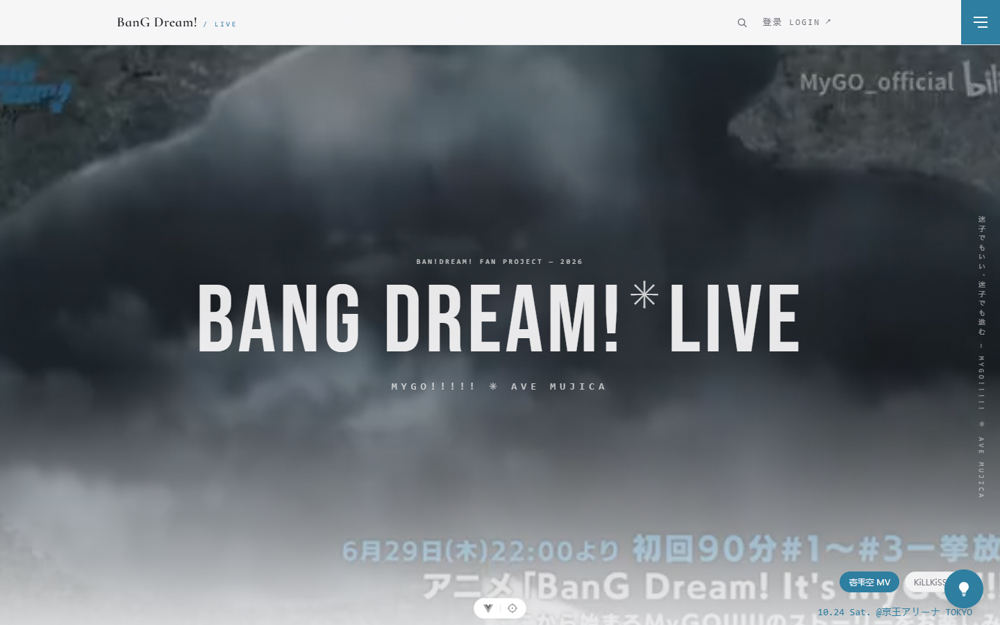
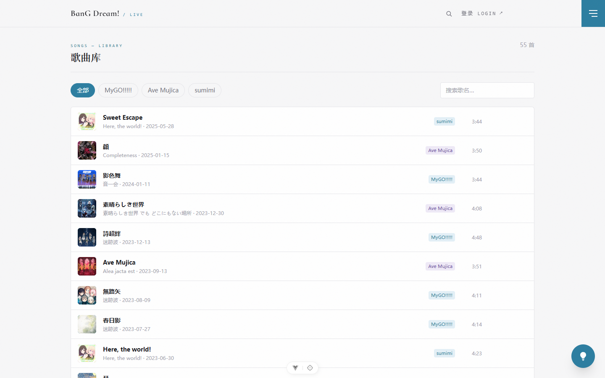
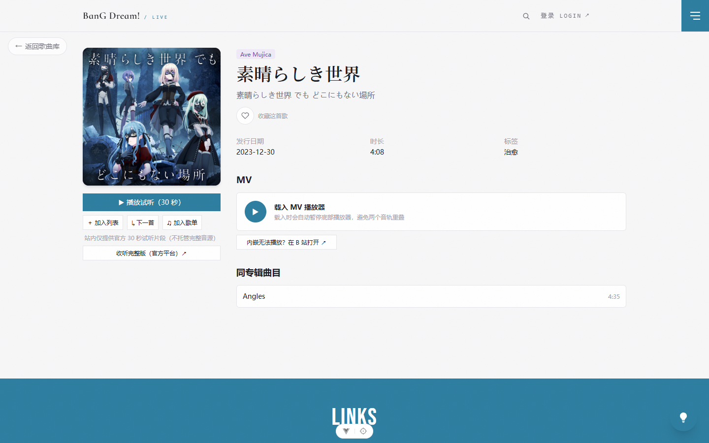
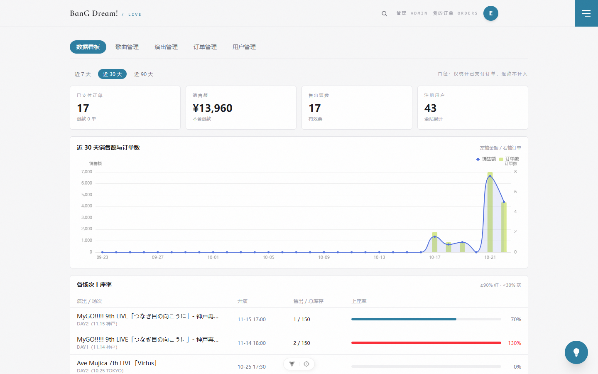

# BanG Dream! Live — MyGO!!!!! × Ave Mujica 粉丝站


> 一个面向 BanG Dream! 粉丝的全栈 Web 应用：曲库试听、B 站 MV、演出票务（防超卖）、收藏与歌单、评论与开售提醒、管理端、AI 助手。
> 由个人独立完成前后端、数据库、测试与部署，用于学习与作品展示；原创代码采用 MIT 许可。

**许可**：原创代码、脚本和文档见 [MIT LICENSE](LICENSE)；第三方音乐、视频、图片、字体与商标不纳入该授权，见 [NOTICE](NOTICE.md)。本站使用官方外链试听与播放器嵌入，具体内容的使用和分发仍须遵守权利方要求。

---

## 项目截图

| 首页 | 歌曲库 |
|---|---|
|  |  |

| 歌曲详情（播放器 + MV） | 管理端数据看板 |
|---|---|
|  |  |

---

## 目录

- [功能总览](#功能总览)
- [技术栈](#技术栈)
- [系统架构](#系统架构)
- [快速开始](#快速开始)
- [测试](#测试)
- [部署](#部署)
- [移动端与素材](#移动端与素材)
- [目录结构](#目录结构)
- [文档索引](#文档索引)
- [开发纪实](#开发纪实)

---

## 功能总览

### 面向访客 / 登录用户

| 模块 | 说明 |
|---|---|
| 曲库 | 55 首歌（MyGO!!!!! / Ave Mujica / sumimi），乐队筛选、关键词搜索（匹配歌名 + 乐队名）、专辑聚合 |
| 试听 | iTunes 官方 30 秒预览外链（49/55 首有源，其余官方未上架，不爬取版权音源） |
| MV | Bilibili 官方账号内嵌播放（优先 MyGO_AveMujica 官方号），番剧页降级为跳转卡片 |
| 演出票务 | 场次/票档/余票展示 → 下单（15 分钟支付倒计时）→ 模拟支付；防超卖、限购校验 |
| 我的订单 | 状态机全展示：待支付 / 已支付 / 已取消 / 已过期 / 已退款 |
| 收藏 | 歌曲 / 演出双向收藏，我的收藏页 |
| 歌单 | 建歌单、加歌、就地新建、歌单详情播放 |
| 评论 | 歌曲评论（发 / 删 / 列表） |
| 开售提醒 | 订阅演出，开售时站内提醒（定时任务扫描） |
| AI 助手 | 四人格人设（小灯 / 祥子 / まな / にゃむ），SSE 流式打字机输出，LLM 不可用时规则引擎兜底 |
| 登录守卫 | 游客点播放 / 购票 → 引导弹窗，登录后回原页 |

### 管理端（仅 ADMIN）

| 模块 | 说明 |
|---|---|
| 数据看板 | 近 30 天营收 / 订单趋势（ECharts），各场次上座率 |
| 歌曲管理 | 行内编辑（音源 / MV / 标签 / 上下架），新建歌曲 |
| 演出管理 | 演出 / 场次 / 票档三级新建与编辑；**三级删除**（软删 + 未完成订单拦截 40903 + 级联） |
| 票档控制 | 下架 / 恢复（status 0/1），库存不得小于已售 |
| 订单管理 | 按状态 / 场次 / 用户筛选，退款（自动回滚库存） |
| 用户管理 | 用户列表、封禁 / 解封（禁止封自己与管理员） |
| Setlist 录入 | 给场次录入曲目与安可标记 |

---

## 技术栈

| 层 | 选型 | 说明 |
|---|---|---|
| 后端 | **Spring Boot 4.1（Java 17）** | Spring MVC + Spring Security（JWT 自校验）+ Spring Data JPA（Hibernate 7.4） |
| 数据库 | **MySQL 8.0** | 全表 InnoDB + utf8mb4_0900_ai_ci；表结构只信 Flyway（55 个迁移），JPA 仅 `ddl-auto: validate` |
| 迁移 | **Flyway** | V1–V55；结构迁移 + 数据迁移（含全部曲库/专辑/成员种子数据），新环境一键自举；新增结构从 V56 起 |
| 前端 | **Vue 3 + Vite 8 + Pinia + Vue Router + Tailwind CSS 4** | 按路由代码分割，ECharts 异步加载；移动端断点 767px |
| 实时 | **SSE**（`SseEmitter` + 线程池） | AI 助手流式输出；开售提醒后台扫描 |
| AI | **双通道：本地 Ollama / 云端 OpenAI 兼容 API** | 同一套客户端支持两条链路（Bearer 鉴权 + tool_calls 增量拼接）；不可用时规则引擎兜底 |
| 测试 | JUnit 5 + MockMvc（168 用例）／Vitest（82 用例）／Playwright（20 用例） | 后端集成测试用真实 MySQL 测试库 |
| 部署 | **Ubuntu 24.04 + systemd + nginx 同源反代** | `scripts/deploy-ubuntu.sh` 一键安装/构建/常驻；本地与服务器均可在同源下访问 |

---

## 系统架构

```
                    ┌────────────────────────────────────┐
   浏览器 ────────► │  nginx :80                         │
                    │  ├─ /            → frontend/dist   │  Vue 3 静态资源
                    │  └─ /api/**      → 127.0.0.1:8080  │  同源反代（免 CORS）
                    └────────────────┬───────────────────┘
                                     │
                    ┌────────────────▼───────────────────┐
                    │  Spring Boot 4.1 :8080             │
                    │  ├─ Security：JWT 过滤器 + RBAC     │
                    │  ├─ 限流：IP 固定窗口（按组配额）    │
                    │  ├─ Controller → Service → Repo    │
                    │  ├─ Flyway：V1–V55 迁移            │
                    │  ├─ 定时任务：场次状态机/提醒/超时   │
                    │  └─ SSE：AI 助手流式                │
                    └────────────────┬───────────────────┘
                                     │
                    ┌────────────────▼───────────────────┐
                    │  MySQL 8 (bandori_live)            │
                    │  19 张表 · InnoDB · utf8mb4        │
                    │  外链：iTunes 预览 / B 站 iframe    │
                    └────────────────────────────────────┘
```

---

## 快速开始

**前置**：JDK 17+、MySQL 8、Node 22+。

```bash
# 1. 数据库：保证 MySQL 在跑即可，库和表由 Flyway 首次启动自动创建并灌入种子数据
# 2. 后端配置（敏感信息不入库）
cd backend
cat > .env <<'EOF'
DB_URL=jdbc:mysql://localhost:3306/bandori_live?useSSL=false&serverTimezone=Asia/Shanghai&allowPublicKeyRetrieval=true&createDatabaseIfNotExist=true
DB_USERNAME=root
DB_PASSWORD=你的数据库密码
JWT_SECRET=至少32位的随机字符串
JWT_EXPIRATION_HOURS=72
EOF

# 3. 后端（Windows: mvnw.cmd / Linux: chmod +x mvnw 后 ./mvnw）
./mvnw spring-boot:run          # http://localhost:8080

# 4. 前端
cd ../frontend
npm install
npm run dev                     # http://localhost:5173（代理已配）
```

管理员账号：将 `user` 表目标用户 `role` 改为 `ADMIN`（参考迁移 `V22__admin_user.sql`）。

> 参考数据由迁移自带，新环境完整运行 Flyway 即可。可选执行
> `mysql --default-character-set=utf8mb4 -u root -p bandori_live < db/seed/reference.sql`
> 更新乐队/成员/专辑/歌曲元数据，并按业务键补齐缺失的演出、场次、票档与曲目单。
> 请在维护期间单进程执行：已有演出域记录（含软删行）保持原样，新票档已售数为 0，
> 不覆盖库存、订单或限购配额；此文件不用于恢复交易数据。使用边界见 [脚本说明](scripts/README.md)。
>
> 首页 Hero 背景素材随仓库分发：`frontend/public/assets/band-mygo-720p.mp4`、`band-mujica-720p.mp4`
> （各 8.4MB，1280×720、无音轨）与两张 `*-poster.jpg` 首帧图。1080P 原片**不入库**，保留在本地
> `assets-src/video/`，需要重新压制时从那里取。体积与带宽的取舍见 [移动端与素材](#移动端与素材)。

管理端可替换两个首页背景视频（MP4，最多100MB，上传超时5分钟）。播放、上传和检测统一使用
`/assets/band-{slot}-720p.mp4`；本地默认写入 `frontend/public/assets`。Ubuntu 部署脚本将上传内容
保存在独立的 `var/hero-assets/`，由 Nginx 提供并重新验证缓存，后续前端构建保留已上传视频。
素材需自行准备适合网页播放的版本，上传不负责转码或更新 poster 首帧图。

---

## 测试

| 层 | 命令 | 规模 |
|---|---|---|
| 后端集成测试 | `./mvnw test`（真实 MySQL 测试库） | **168 用例 / 35 个测试类**，含并发购票/支付取消/确认抢占、SSE 流式、限流、权限负例、令牌吊销、LLM 客户端鉴权与分片拼接、小灯复读治理 |
| 前端单测 | `npm run test`（Vitest + jsdom） | **82 用例 / 10 个文件**（请求封装 / 播放器 / 表单校验 / 小灯事件流 / 首页区块） |
| E2E 旅程 | `npm run test:e2e`（Playwright，本机用 Edge） | **20 用例 / 8 个 spec**：游客浏览 / 歌单 / 购票 / **管理端删除全链路** |

E2E 中引入了 **DELETE 探针**模式：删除类断言前先 `waitForResponse` 打印 HTTP 状态与响应体，区分「接口失败」与「成功但 UI 未刷新」两类问题。

一键跑后端 + 前端基线：`scripts\check.bat`（E2E 加参数：`scripts\check.bat e2e`）。
Linux/macOS 使用 `bash scripts/check.sh`；PowerShell 7 也可执行 `./scripts/check.ps1`。追加 `tools` 只验证本机工具，发现规则见 [scripts/README.md](scripts/README.md)。

GitHub Actions 在 push、PR 和手动触发时运行：Java 17 + 临时 MySQL 8.0 执行后端测试及打包，
Node 24 执行 `npm ci`、前端单测与构建。测试库每次独立创建，CI 使用的公开测试口令不用于部署。
工作流只授予读取仓库权限，第三方 Action 固定到完整提交哈希，由 Dependabot 跟踪更新。

---

## 部署

当前服务器部署入口是 `scripts/deploy-ubuntu.sh`，面向 Ubuntu 22.04/24.04。脚本会安装运行依赖、构建前后端，并配置 systemd 与 Nginx。请在仓库根目录、服务器代码目录中执行：

```bash
sudo bash scripts/deploy-ubuntu.sh
```

部署参数与手动运维命令见 [scripts/README.md](scripts/README.md)。数据库备份脚本将新文件写入 `backup/db/`，不会移动其他本地备份文件。

脚本默认部署当前干净检出；显式设置 `USE_GIT=1` 才进行快进更新。它安装运行依赖、按 `.nvmrc` 准备 Node、创建专用数据库账号、构建前后端、以 `avemygo` 系统账号运行后端，并验证数据库 readiness 和 Nginx 代理。重复执行保留已有凭据；探针失败会返回非零，部署前请保留上一发布版本。配置渲染与权限说明见脚本文档。

**AI 助手（小灯）的环境变量**（不配则助手返回 50301，站内其他功能不受影响）：

| 变量 | 说明 | 示例 |
|---|---|---|
| `LLM_BASE_URL` | OpenAI 兼容的 chat completions 地址 | 本地 `http://localhost:11434/v1/chat/completions`；云端如 `https://api.deepseek.com/v1/chat/completions` |
| `LLM_MODEL` | 模型名（云端必须显式配置） | `qwen3:8b` / `deepseek-chat` |
| `LLM_API_KEY` | 云 API Key（本地 Ollama 留空） | `sk-...` |

**限流相关**：`RATE_LIMIT_AUTH` / `RATE_LIMIT_ORDER` / `RATE_LIMIT_ASSISTANT` /
`RATE_LIMIT_DEFAULT`（默认 10/20/20/120 每分钟）、`RATE_LIMIT_TRUSTED_PROXIES`
（只有这些代理地址发来的 `X-Forwarded-For` 才被采信）。

上线自检清单：`/ready` 探针、生产 CORS 域名、限流阈值、数据库备份脚本（`scripts/backup-db.bat`）、日志级别。

---

## 移动端与素材

### 移动端适配（断点 767px）

- **导航单行**：Logo 降为 `text-base`，窄屏隐藏 `/ LIVE` 与 `LOGIN` 英文，只留「登录 ↗」；`flex-nowrap + shrink-0` 禁止折行
- **Hero 高度**：`calc(100svh - 4rem)` 扣掉 sticky 顶栏，底部演出信息不会被推出视口
- **视频不自动下载**：手机端 `preload="none"` 且无 `autoplay`，先显示 poster 首帧，点「壱雫空 MV ▶」才 `load() + play()`
- **加载过渡**：视频 `canplay` 后才 `opacity-1` 淡入，未就绪不会有黑框；视频与海报都失败才回退渐变兜底
- **底部信息**：日期单行省略、标题最多两行，并为右下角悬浮球留出右侧空间

### 素材与体积

| 素材 | 位置 | 规格 | 入库 |
|---|---|---|---|
| Hero 视频（网页用） | `frontend/public/assets/band-*-720p.mp4` | 1280×720 · 89s/88s · 各 8.4MB | ✅ |
| 首帧 poster | `frontend/public/assets/band-*-poster.jpg` | 1280 宽 · 58KB/45KB | ✅ |
| OP 原片 | `assets-src/video/*_1080P.mp4` | 1920×1080 · 26MB/30MB | ❌ gitignore |
| 封面图 | `frontend/public/img/covers/` | 700×700 · JPEG q82 | ✅ |

压制参数（ffmpeg 免安装版即可）：

```bash
ffmpeg -i 原片.mp4 -t 89 -vf "scale=-2:720:flags=lanczos" \
       -c:v libx264 -preset slow -crf 34 -pix_fmt yuv420p -an \
       -movflags +faststart out-720p.mp4
```

`-an` 是因为页面 `<video muted autoplay loop>` 本来就不出声；`+faststart` 让 moov 前置，边下边播。
`dist` 约 29MB（视频占 17MB）。1Mbps 量级的公网带宽下 8.4MB 需约 2 分钟缓冲，**所以移动端选择点播而非自动播放**——自动播放在窄带下等于让访客对着空画面等待。

---

## 目录结构

```
├── backend/              # Spring Boot 后端
│   └── src/main/resources/db/migration/   # V1–V55 Flyway 迁移（已冻结，新结构从 V56 起）
├── frontend/              # Vue 3 前端
│   ├── public/assets/     # Hero 视频(720p) 与 poster 首帧（随仓库分发）
│   └── e2e/               # Playwright E2E
├── db/seed/reference.sql  # 目录元数据更新 + 演出域按业务键补录（保留交易数据）
├── docs/                  # 现行设计文档 + 截图（docs/img/）
│   └── archive/           # 历史任务书、审计报告、开发纪实
├── scripts/               # 本地开发、数据审计、备份、Ubuntu 部署（见 scripts/README.md）
├── assets-src/            # 本地素材（video/ 放 OP 1080P 原片，images/ 放原图；不入库）
├── backup/                # 本地数据库/.git 备份（数据库导出放 backup/db/）与一次性脚本（不入库）
└── AGENTS.md              # 工程全景（约定 / 数据模型 / 接口 / 红线）
```

## 文档索引

| 文档 | 内容 |
|---|---|
| [docs/04-需求说明.md](docs/04-需求说明.md) | 产品需求与页面结构 |
| [docs/05-数据库设计.md](docs/05-数据库设计.md) | 数据库建模（含 V50–V55 新增 3 张表） |
| [docs/06-接口设计.md](docs/06-接口设计.md) | REST 契约 |
| [docs/08a-上线检查清单.md](docs/08a-上线检查清单.md) | 生产部署自检 |
| [docs/08b-测试与验收.md](docs/08b-测试与验收.md) | 测试策略 |
| [docs/09b-环境与依赖清单.md](docs/09b-环境与依赖清单.md) | 本机/部署环境与依赖版本 |
| [docs/SQL迁移总览.md](docs/SQL迁移总览.md) | V1–V55 迁移明细 |
| [docs/10-Agent运营层设计.md](docs/10-Agent运营层设计.md) | Agent 能力设计（工具/循环/门控/审计/多轮/预热） |
| [docs/13-小灯v2方案.md](docs/13-小灯v2方案.md) | 小灯 v2：删模式开关 + 对话质量重做 |
| [docs/17-后续演进计划.md](docs/17-后续演进计划.md) | 产品演进：来源基座 / 演出档案闭环 / 个人空间 / AI 引用 |
| [docs/18-工程深度与体量方案.md](docs/18-工程深度与体量方案.md) | 七个 L3 模块、可量化证明与落地可行性 |
| [docs/19-未完成事项清单.md](docs/19-未完成事项清单.md) | 未完成项与已知风险（P0/P1 分级） |
| [docs/metrics.md](docs/metrics.md) | 项目度量快照（规模/测试/数据的**唯一数字口径**） |

历史文档（一次性任务书、数据审计、演出数据核验、开发纪实）统一放在
[docs/archive/](docs/archive/)，不再逐个列出。

---

## 开发纪实

小灯 Agent 化升级、代码审阅修复、一周开发实录、踩坑记录已归档：
[docs/archive/开发纪实-2026-10至11.md](docs/archive/开发纪实-2026-10至11.md)。
