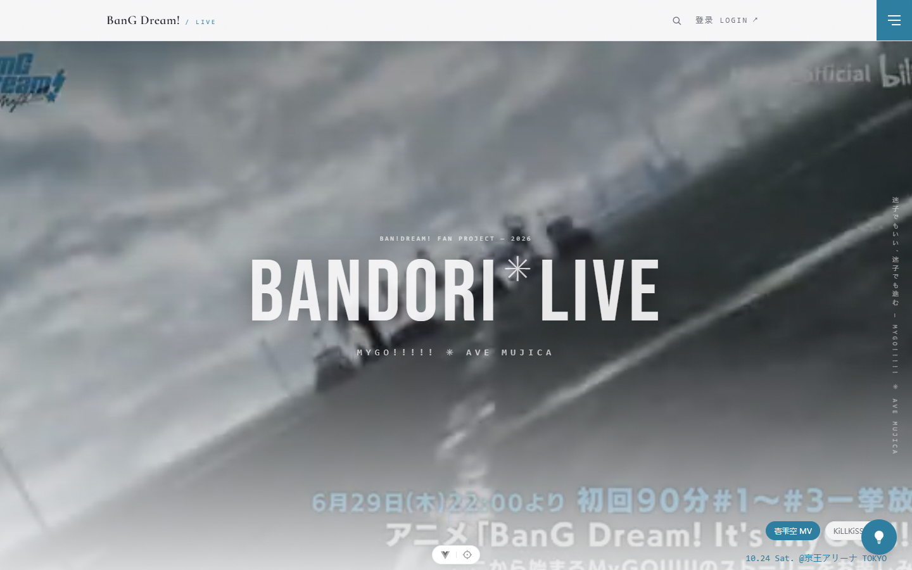
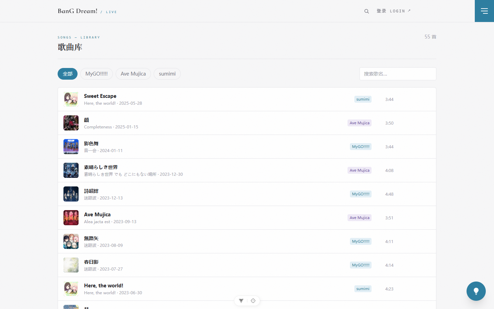
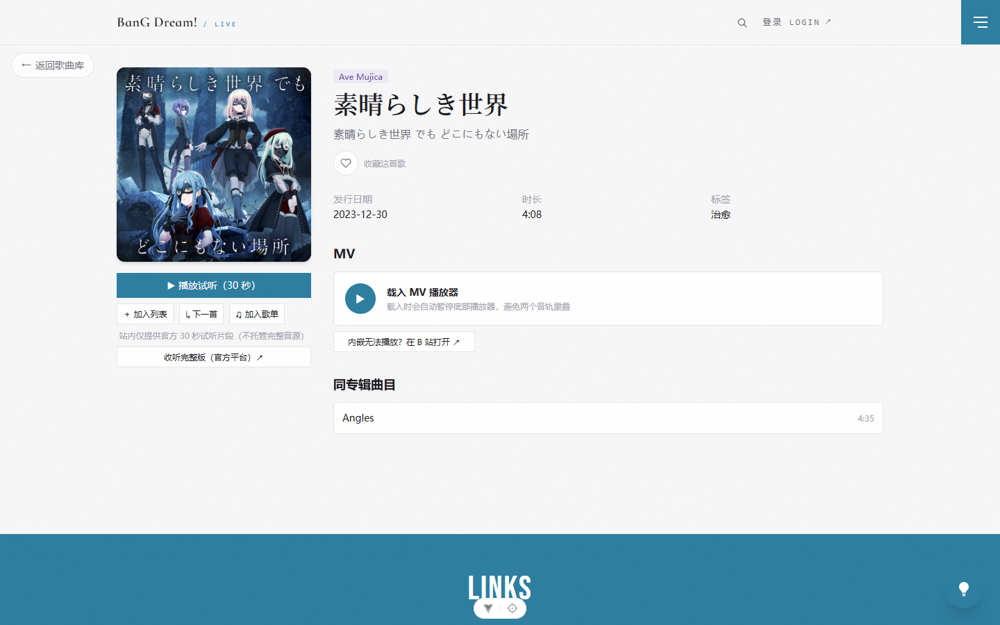
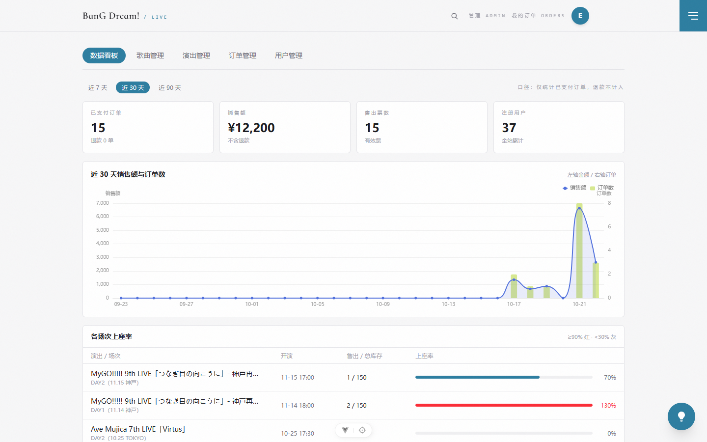

# BanG Dream! Live — MyGO!!!!! × Ave Mujica 粉丝站

> 一个面向 BanG Dream! 粉丝的全栈 Web 应用：曲库试听、B 站 MV、演出票务（防超卖）、收藏与歌单、评论与开售提醒、管理端、AI 助手。
> 由个人独立完成前后端、数据库、测试与部署，**仅供学习参考，不做任何商业目的**。

**声明**：本项目为非商业性粉丝学习项目。BanG Dream!（バンドリ！）及 MyGO!!!!!、Ave Mujica 等相关名称、角色、音乐、图像著作权归 **株式会社ブシロード（Bushiroad Inc.）** 及各权利方所有；本项目不存储任何版权音频与官方素材，试听均为 Apple iTunes 官方 30 秒预览外链，MV 为 Bilibili 官方账号内嵌播放。如有侵权请联系删除。

---

## 项目截图

| 首页 | 歌曲库 |
|---|---|
|  |  |

| 歌曲详情（播放器 + MV） | 管理端数据看板 |
|---|---|
|  |  |

---

## 目录

- [功能总览](#功能总览)
- [技术栈](#技术栈)
- [系统架构](#系统架构)
- [快速开始](#快速开始)
- [测试](#测试)
- [部署](#部署)
- [目录结构](#目录结构)
- [文档索引](#文档索引)
- [一周开发实录](#一周开发实录)
- [踩坑记录：真实的错误](#踩坑记录真实的错误)
- [难点与解决方案](#难点与解决方案)
- [技术点与创新点](#技术点与创新点)
- [数据可信度声明](#数据可信度声明)

---

## 功能总览

### 面向访客 / 登录用户

| 模块 | 说明 |
|---|---|
| 曲库 | 55 首歌（MyGO!!!!! / Ave Mujica / sumimi），乐队筛选、关键词搜索（匹配歌名 + 乐队名）、专辑聚合 |
| 试听 | iTunes 官方 30 秒预览外链（49/55 首有源，其余官方未上架，不爬取版权音源） |
| MV | Bilibili 官方账号内嵌播放（优先 MyGO_AveMujica 官方号），番剧页降级为跳转卡片 |
| 演出票务 | 场次/票档/余票展示 → 下单（15 分钟支付倒计时）→ 模拟支付；防超卖、限购校验 |
| 我的订单 | 状态机全展示：待支付 / 已支付 / 已取消 / 已过期 / 已退款 |
| 收藏 | 歌曲 / 演出双向收藏，我的收藏页 |
| 歌单 | 建歌单、加歌、就地新建、歌单详情播放 |
| 评论 | 歌曲评论（发 / 删 / 列表） |
| 开售提醒 | 订阅演出，开售时站内提醒（定时任务扫描） |
| AI 助手 | 四人格人设（小灯 / 祥子 / まな / にゃむ），SSE 流式打字机输出，LLM 不可用时规则引擎兜底 |
| 登录守卫 | 游客点播放 / 购票 → 引导弹窗，登录后回原页 |

### 管理端（仅 ADMIN）

| 模块 | 说明 |
|---|---|
| 数据看板 | 近 30 天营收 / 订单趋势（ECharts），各场次上座率 |
| 歌曲管理 | 行内编辑（音源 / MV / 标签 / 上下架），新建歌曲 |
| 演出管理 | 演出 / 场次 / 票档三级新建与编辑；**三级删除**（软删 + 未完成订单拦截 40903 + 级联） |
| 票档控制 | 下架 / 恢复（status 0/1），库存不得小于已售 |
| 订单管理 | 按状态 / 场次 / 用户筛选，退款（自动回滚库存） |
| 用户管理 | 用户列表、封禁 / 解封（禁止封自己与管理员） |
| Setlist 录入 | 给场次录入曲目与安可标记 |

---

## 技术栈

| 层 | 选型 | 说明 |
|---|---|---|
| 后端 | **Spring Boot 4.1（Java 17）** | Spring MVC + Spring Security（JWT 自校验）+ Spring Data JPA（Hibernate 7.4） |
| 数据库 | **MySQL 8.0** | 全表 InnoDB + utf8mb4_0900_ai_ci；表结构只信 Flyway（49 个迁移），JPA 仅 `ddl-auto: validate` |
| 迁移 | **Flyway** | V1–V49；结构迁移 + 数据迁移（含全部曲库/专辑/成员种子数据），新环境一键自举 |
| 前端 | **Vue 3 + Vite 8 + Pinia + Vue Router + Tailwind CSS 4** | 按路由代码分割，ECharts 异步加载 |
| 实时 | **SSE**（`SseEmitter` + 线程池） | AI 助手流式输出；开售提醒后台扫描 |
| AI | **Ollama**（qwen3:8b，OpenAI 兼容端点） | 本地推理，不可用时规则引擎兜底，格式一致 |
| 测试 | JUnit 5 + MockMvc（112 用例）／Vitest（23 用例）／Playwright（E2E 旅程） | 后端集成测试用真实 MySQL 测试库 |
| 部署 | jar + nginx 同源反代 | CloudStudio 演示环境 / 任意 Linux VPS 均可 |

---

## 系统架构

```
                    ┌────────────────────────────────────┐
   浏览器 ────────► │  nginx :80                         │
                    │  ├─ /            → frontend/dist   │  Vue 3 静态资源
                    │  └─ /api/**      → 127.0.0.1:8080  │  同源反代（免 CORS）
                    └────────────────┬───────────────────┘
                                     │
                    ┌────────────────▼───────────────────┐
                    │  Spring Boot 4.1 :8080             │
                    │  ├─ Security：JWT 过滤器 + RBAC     │
                    │  ├─ 限流：IP 固定窗口（按组配额）    │
                    │  ├─ Controller → Service → Repo    │
                    │  ├─ Flyway：V1–V49 迁移            │
                    │  ├─ 定时任务：场次状态机/提醒/超时   │
                    │  └─ SSE：AI 助手流式                │
                    └────────────────┬───────────────────┘
                                     │
                    ┌────────────────▼───────────────────┐
                    │  MySQL 8 (bandori_live)            │
                    │  16 张表 · InnoDB · utf8mb4        │
                    │  外链：iTunes 预览 / B 站 iframe    │
                    └────────────────────────────────────┘
```

---

## 快速开始

**前置**：JDK 17+、MySQL 8、Node 22+。

```bash
# 1. 数据库：保证 MySQL 在跑即可，库和表由 Flyway 首次启动自动创建并灌入种子数据
# 2. 后端配置（敏感信息不入库）
cd ave-mygo
cat > .env <<'EOF'
DB_URL=jdbc:mysql://localhost:3306/bandori_live?useSSL=false&serverTimezone=Asia/Shanghai&allowPublicKeyRetrieval=true&createDatabaseIfNotExist=true
DB_USERNAME=root
DB_PASSWORD=你的数据库密码
JWT_SECRET=至少32位的随机字符串
JWT_EXPIRATION_HOURS=72
EOF

# 3. 后端（Windows: mvnw.cmd / Linux: chmod +x mvnw 后 ./mvnw）
./mvnw spring-boot:run          # http://localhost:8080

# 4. 前端
cd ../frontend
npm install
npm run dev                     # http://localhost:5173（代理已配）
```

管理员账号：将 `user` 表目标用户 `role` 改为 `ADMIN`（参考迁移 `V22__admin_user.sql`）。

---

## 测试

| 层 | 命令 | 规模 |
|---|---|---|
| 后端集成测试 | `./mvnw test`（真实 MySQL 测试库） | **112 用例**，含并发购票压测、SSE 流式、限流、权限负例 |
| 前端单测 | `npm run test`（Vitest + jsdom） | 23 用例（请求封装 / 播放器 / 表单校验） |
| E2E 旅程 | `npm run test:e2e`（Playwright + Edge） | 游客浏览 / 歌单 / 购票 / **管理端删除全链路** |

E2E 中引入了 **DELETE 探针**模式：删除类断言前先 `waitForResponse` 打印 HTTP 状态与响应体，区分「接口失败」与「成功但 UI 未刷新」两类问题。

---

## 部署

演示环境（腾讯云 CloudStudio）已跑通全流程，生产迁移到任意 Linux VPS 步骤相同：

```bash
# 后端
./mvnw -q package -DskipTests
nohup env DB_URL=... DB_USERNAME=... DB_PASSWORD=... JWT_SECRET=... \
  java -jar target/ave-mygo-*.jar > backend.log 2>&1 &

# 前端（关键：同源路径，覆盖 .env.production 的 localhost）
cd frontend && VITE_API_BASE=/api/v1 npm install && VITE_API_BASE=/api/v1 npm run build

# nginx：托 dist + /api 反代 8080（配置见 docs/08-上线检查清单.md）
```

上线自检清单：`/ready` 探针、生产 CORS 域名、限流阈值、数据库备份脚本（`scripts/backup-db.bat`）、日志级别。

---

## 目录结构

```
├── ave-mygo/              # Spring Boot 后端
│   └── src/main/resources/db/migration/   # V1–V49 Flyway 迁移（含数据）
├── frontend/              # Vue 3 前端
│   └── e2e/               # Playwright E2E
├── docs/                  # 设计文档 + 审计报告 + 截图（docs/img/）
├── scripts/               # 构建 / 启动 / 备份脚本
└── AGENT.md               # 工程全景（约定 / 数据模型 / 接口 / 红线）
```

## 文档索引

| 文档 | 内容 |
|---|---|
| [docs/04-需求说明.md](docs/04-需求说明.md) | 产品需求与页面结构 |
| [docs/05-数据库设计.md](docs/05-数据库设计.md) | 16 张表建模 |
| [docs/06-接口设计.md](docs/06-接口设计.md) | REST 契约 |
| [docs/08-上线检查清单.md](docs/08-上线检查清单.md) | 生产部署自检 |
| [docs/08-测试与验收.md](docs/08-测试与验收.md) | 测试策略 |
| [docs/09-数据审计报告.md](docs/09-数据审计报告.md) | 全量数据审计与修正记录 |
| [docs/SQL迁移总览.md](docs/SQL迁移总览.md) | V1–V49 迁移明细 |

---

## 一周开发实录

> 2026-10-15 立项 → 2026-10-22 上线，个人独立完成，全程「AI 当教练、人写代码」的协作模式。

| 日期 | 里程碑 |
|---|---|
| 10-15 | 需求定档：粉丝站 = 音乐播放（官方外链）+ 演出票务（模拟支付）+ 内容管理；定技术栈 |
| 10-16~17 | 后端骨架：Flyway 建模 16 张表、JWT 认证、曲库 CRUD、购票防超卖、订单状态机 |
| 10-18 | 管理端 + AI 助手（Ollama 四人格）；粉丝向数据第一次发现事实错误，确立「官方资料为准」原则 |
| 10-19 | 数据底座完善：专辑/成员/试听/MV 批量核对；全站封版 M1–M4.10 |
| 10-20~21 | 功能冲刺：18 项剩余清单逐项交付（收藏/歌单/看板/用户管理/搜索/Setlist/评论/提醒/SSE），前端全部接入；生产加固（限流、/ready、CORS 配置化、备份脚本） |
| 10-21~22 | **全量数据审计**：45+ 迁移、16 项完整性检查、56 首音频逐个 HTTP 验证、47 条 MV 逐个调 B 站接口核验 |
| 10-22 | 管理端三级删除 + 管理端 E2E；CloudStudio 演示环境上线（MySQL + jar + nginx 同源） |

## 踩坑记录：真实的错误

> 以下全部是本项目真实踩过的坑，按「现象 → 根因 → 修法」记录，供后来者参考。

### 1. Flyway 版本号冲突——迁移编号也是「并发资源」
两个功能分支同时占用了 `V42`。启动报 `Found more than one migration with version 42`。
**修法**：评论改 V43、提醒改 V44。教训：迁移版本号在多人/多会话协作中要先占坑，或一人统一管理。

### 2. 已手工执行的迁移被 Flyway 重放——所有迁移必须幂等
本地手工执行过 `V49`（`ALTER TABLE ADD COLUMN`）后，Flyway 启动重放报 `Duplicate column name`，应用起不来。
**修法**：MySQL 8 没有 `ADD COLUMN IF NOT EXISTS`，改用 `INFORMATION_SCHEMA.COLUMNS` 守卫 + `PREPARE/EXECUTE` 动态执行；数据迁移一律 `UPDATE ... WHERE` / `INSERT IGNORE`。**任何迁移都可能被重放**，这是纪律。

### 3. JPA 派生删除 + 唯一键 = 幽灵冲突
`setlist_item` 有唯一键 `(session_id, order_no)`，全量替换时用派生 `deleteBySessionId()` 报 Duplicate entry——派生删除是先查后逐条删，删除动作排队到 flush，**新行先插入**导致撞键。
**修法**：显式 `@Modifying(flushAutomatically = true) @Query("DELETE ...")` 强制立即落库。

### 4. 「删不掉」假象：删除成功，界面没刷新
管理端删除场次，后端 0.09s 返回成功，但界面死活不刷新。根因：**公开端与管理端两套 `SessionView` DTO 字段不对齐**——公开端没有 `eventId`，前端拿到 `undefined` 去刷新，请求 404 被吞。
**修法**：DTO 对齐（补 `eventId`）；E2E 里加 **DELETE 探针**（`waitForResponse` 打印状态码 + 响应体），从此「接口失败」和「成功但 UI 没刷」一眼可辨。

### 5. 幻影数据：EP 名 ≠ 歌名
库里存在「Ave Mujica の旗印」这张专辑和「ELEMENTS」这首歌——**官方根本不存在**。前者是纯幻觉数据，后者是「迷你专辑名叫 ELEMENTS，但专辑里没有叫 ELEMENTS 的曲目」。
**修法**：软删；并确立铁律——**粉丝向数据一切以官方 discography 为准，查不到 = 不存在，宁缺毋滥**。

### 6. 粉丝向事实错误：细节错一个字母都会被骂
`MyGO!!!!`（4 个感叹号）→ 官方是 **5 个**；祐天寺にゃむ的担当写成 `Dj.` → 官方是 **Dr.（双踏）**；三角初華 `Vo.` → **Gt. & Vo.**。
**修法**：V45 迁移修正 + 测试断言同步。教训：**做同人项目，事实错误的代价远大于功能缺失**。

### 7. 前端构建写死 localhost：访客浏览器连自己的机器
`.env.production` 里 `VITE_API_BASE=http://localhost:8080`，部署后所有访客的浏览器都去连**他们自己电脑**的 8080。
**修法**：构建时 `VITE_API_BASE=/api/v1` + nginx 同源反代，顺带消灭了全部 CORS 问题。

### 8. 手工执行的 SQL 与 Flyway 历史不同步（环境变量密码漂移）
`.env`、数据库账号、启动命令三处密码各自漂移，后端 `Access denied` 排查半天。
**修法**：改用 `nohup env DB_PASSWORD=... java -jar` 环境变量注入，一处生效；本地 `.env` 用脚本同步。

### 9. 其他真实的坑
- `Map.of()` 不可变 Map 对 null key 调 `get()` 直接 NPE（歌单为空时）→ 换 `HashMap` + 判空
- 搜索只匹配歌名，搜「MyGO」搜不到歌 → 扩展为 `EXISTS` 子查询匹配乐队名
- 全局 `/auth/**` permitAll 导致 `GET /auth/me` 匿名可访问 → 收紧到仅 `register`/`login`
- Windows 机器残留 `SERVER_PORT=10027` 环境变量，本地启动端口诡异漂移 → `env -u SERVER_PORT` 排除
- Spring `PageImpl` 直接序列化的稳定性警告 → 按 Spring Data 建议改用 PagedModel
- 容器里粘贴 heredoc 被 zsh 自动转义 `\;`，nginx 配置非法 → 用 `sed` 修正而非重贴

## 难点与解决方案

### 防超卖：一条 UPDATE 解决竞态
```sql
UPDATE ticket_type SET sold_count = sold_count + :qty
WHERE id = :id AND status = 1 AND sold_count + :qty <= total_stock
```
检查与扣减在**一条原子 UPDATE** 里完成，WHERE 不满足 = 0 行受影响 = 售罄信号，**不存在先查后改的竞态窗口**；数据库层另有 `CHECK (sold_count <= total_stock)` 兜底。取消/退款/超时走对称的 `decreaseSold`（`sold_count >= :qty` 保证永不为负）。

### 订单状态机 + 全路径库存回滚
`PENDING_PAYMENT → PAID → REFUNDED` / `PENDING_PAYMENT → CANCELLED(用户)` / `PENDING_PAYMENT → EXPIRED(超时任务)`。每一条非 PAID 终态都对称回滚库存；退款走管理端专用接口并记录原因。

### 软删除体系
`band / album / song / member / live_event / live_session / ticket_type / setlist_item` 统一 `is_deleted` 列 + Hibernate `@SQLRestriction("is_deleted = 0")`，查询层自动过滤、无需每个方法手写 WHERE；管理端删除接口因此只需一行置位 + 级联批量 UPDATE。

### SSE 流式 AI 助手
`SseEmitter` + 独立线程池异步推送，前端 fetch 手写 SSE 解析（跨分片拼接 + 打字机渲染 + 停止生成）；LLM 宕机时降级为规则引擎，输出格式保持一致，测试可断言。

### 生产加固
IP 固定窗口限流（按接口组配额）、`/ready` 就绪探针、CORS 白名单配置化、结构化日志贯穿请求 ID、数据库每日备份脚本、`spring.config.import: optional:file:.env` 敏感信息隔离。

## 技术点与创新点

1. **Flyway 数据自举**：内容数据（55 首歌、专辑、成员、场次、票档、文本）全部写成迁移，**新环境零手工导库**，`mvnw spring-boot:run` 一次启动 = 完整可用的站。
2. **数据可信度工程**：为「粉丝向数据的正确性」建立流程——官方 discography 为唯一事实源、UP 主 mid 白名单、逐条 HTTP/接口核验、审计脚本 + 报告入库。
3. **E2E DELETE 探针**：用 `waitForResponse` 把删除类接口的真实响应打进测试输出，区分接口失败与 UI 假象——排查「删不掉」类问题的通用模式。
4. **幂等迁移三件套**：`UPDATE ... WHERE` / `INSERT IGNORE` / `INFORMATION_SCHEMA` 守卫，保证迁移在任何历史状态下重放安全。
5. **AI 四人格**：一个接口按人设参数切换语气与知识范围，SSE 流式 + 降级兜底，演示效果与工程健壮性兼得。
6. **同源反代**：nginx 一个端口同时服务静态资源与 API，从架构上消灭 CORS 配置面。

## 数据可信度声明

- 曲库事实（成员 / 担当 / 乐队名 / 曲目 / 专辑归属）已对照 **BanG Dream! 官方 discography（bang-dream.com）与 Bandori Wiki** 逐条核验，修正记录见 `docs/09-数据审计报告.md` 与迁移 V45–V48
- MV 均经 Bilibili `view` 接口逐条验证（可播放、标题匹配、UP 主为官方账号 MyGO_AveMujica / THE FIRST TAKE）
- 官方无预览 / 无 MV 的曲目（4 + 7 首）**如实标注为空**，不爬取、不伪造

---

## 许可与免责

- 本项目代码仅供学习交流，**不做任何商业目的，禁止用于商业用途**
- BanG Dream!、MyGO!!!!!、Ave Mujica、sumimi 等名称与一切相关素材的著作权归 **Bushiroad Inc. / 株式会社ブシロード** 及各权利方所有
- 本项目不存储、不分发任何版权音频；试听为 Apple Music 官方预览外链，MV 为 Bilibili 官方账号内嵌播放
- 若权利方认为本项目侵犯其权益，请联系删除

**如果这个项目对你有帮助，欢迎 Star；发现数据或代码问题请提 Issue。**
